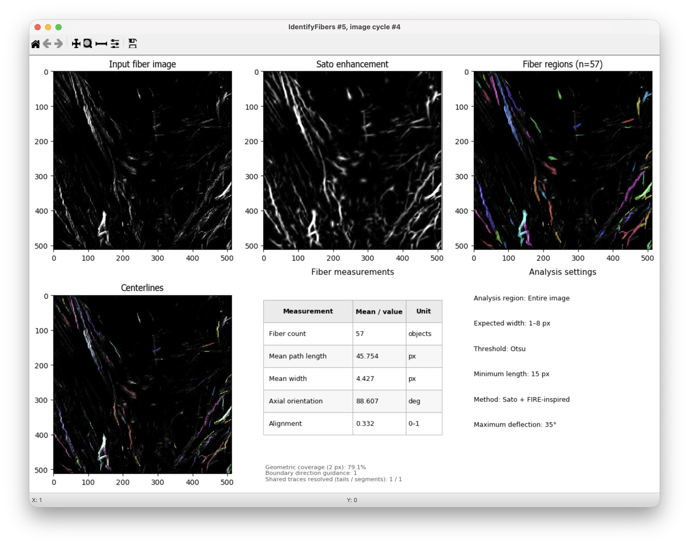

# IdentifyFibers — Sato + FIRE-inspired

[Português](README.pt-BR.md) · [English manual](docs/manual.en.md) · [Manual em português](docs/manual.pt-BR.md)

*Representative CellProfiler output: 79 fiber objects. Example settings: widths 1–4 px, Otsu, minimum length 15 px, maximum deflection 35°. Supplied screenshot; these settings are not the plugin defaults.*

A Python plugin for identifying and measuring bright fibers in **2D grayscale images** in CellProfiler. We use a Sato enhancement highlights elongated structures; a FIRE-inspired tracer to extracts centerlines, and a direction- and intensity-guided partition to assigns region pixels to individual objects.

The plugin uses NumPy, SciPy, scikit-image and Matplotlib from the CellProfiler environment. This is an independent implementation, not an equivalent port of FIRE or CT-FIRE.

**First public release: v1.0.0.**

## Install

1. Close CellProfiler. Locate its configured **plugins folder** in Preferences.
2. Back up the existing IdentifyFibers files outside that folder.
3. Copy **both** `active_plugins/identifyfibers.py` and the entire `active_plugins/identifyfibers_engine/` folder into the plugins folder. Replace the previous copies; do not install the tests or documentation as modules.
4. Restart CellProfiler and add **IdentifyFibers** under **Object Processing**. Keep only one installed wrapper and engine.
5. Load a representative image and run in test mode. See the [quick start](docs/manual.en.md#quick-start).

Optional package check: `python verify_package.py /absolute/path/to/plugins`. This verifies file hashes; it does not replace testing inside CellProfiler.

## Documentation

The manuals provide installation, biological interpretation of increasing/decreasing parameters, processing diagrams, measurement definitions, troubleshooting and references. The plugin help is in English.

- [User manual — English](docs/manual.en.md)
- [Manual de uso — Português](docs/manual.pt-BR.md)
- [Validation and release notes](VALIDATION.md)

- [Preparing the GitHub release](docs/PUBLISHING.md)

## Scientific basis

Based on FIRE principles described by **Stein AM, Vader DA, Jawerth LM, Weitz DA, Sander LM.** An algorithm for extracting the network geometry of three-dimensional collagen gels. *Journal of Microscopy*. 2008;232(3):463–475. [doi:10.1111/j.1365-2818.2008.02141.x](https://doi.org/10.1111/j.1365-2818.2008.02141.x).

The original FIRE addressed 3D networks; this plugin implements a 2D Sato-based workflow.

See [NOTICE.txt](NOTICE.txt), [FIRE license](LICENSE_FIRE.txt) and [package license](LICENSE). Attribution does not imply endorsement by the original authors.
