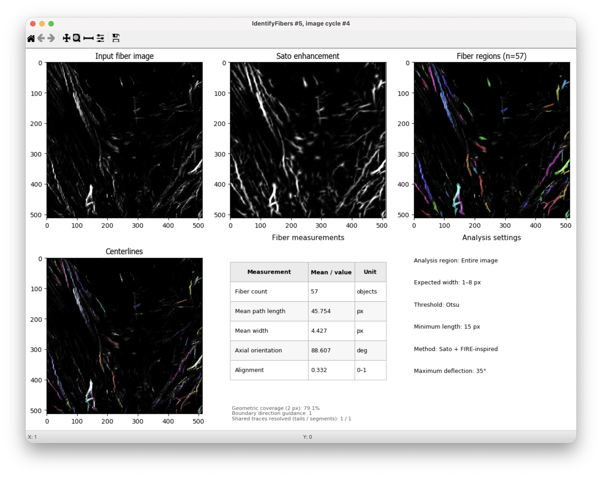

# IdentifyFibers — Sato + FIRE-inspired

[English](README.md) · [Manual em português](docs/manual.pt-BR.md) · [English manual](docs/manual.en.md)

*Resultado representativo no CellProfiler: 57 objetos de fibra. Ajustes do exemplo: larguras de 1–8 px, Otsu, comprimento mínimo de 15 px e deflexão máxima de 35°. Captura fornecida pelo usuário; esses valores são os padrões do plugin.*

Plugin do CellProfiler para identificar e medir fibras claras em **imagens 2D em tons de cinza**. O realce Sato destaca estruturas alongadas; um rastreador inspirado no FIRE extrai as linhas centrais, e uma divisão orientada pela direção e pela intensidade atribui os pixels das regiões aos objetos.

O plugin oferece o método: **Sato + FIRE-inspired**. Utiliza NumPy, SciPy, scikit-image e Matplotlib do ambiente do CellProfiler. Não requer MATLAB, instalação do CT-FIRE, pacote de curvelets ou download de modelos. É uma implementação independente, sem equivalência numérica estabelecida com FIRE ou CT-FIRE.

**Primeira versão pública: v1.0.0.** 

## Instalação

1. Feche o CellProfiler. Localize nas preferências a pasta configurada para plugins.
2. Guarde uma cópia dos arquivos anteriores do IdentifyFibers fora dessa pasta.
3. Copie **os dois componentes**: `active_plugins/identifyfibers.py` e a pasta completa `active_plugins/identifyfibers_engine/`. Substitua as cópias anteriores; não instale os testes ou a documentação como módulos.
4. Reinicie o CellProfiler e adicione **IdentifyFibers**, na categoria **Object Processing**. Mantenha apenas uma cópia instalada do módulo e do mecanismo de análise.
5. Execute uma imagem representativa em modo de teste. Consulte o [início rápido](docs/manual.pt-BR.md#início-rápido).

Verificação opcional: `python verify_package.py /caminho/absoluto/para/plugins`. O comando confere os hashes dos arquivos, mas não substitui a execução no CellProfiler.

## Documentação

Os manuais apresentam instalação, efeitos biológicos esperados ao aumentar ou diminuir os parâmetros, diagramas de processamento, definições das medidas, resolução de problemas e referências. O help do plugin está em inglês.

- [Manual de uso — Português](docs/manual.pt-BR.md)
- [User manual — English](docs/manual.en.md)
- [Validação e notas da versão](VALIDATION.md)

## Base científica

Baseado nos princípios do FIRE descritos por **Stein AM, Vader DA, Jawerth LM, Weitz DA, Sander LM.** An algorithm for extracting the network geometry of three-dimensional collagen gels. *Journal of Microscopy*. 2008;232(3):463–475. [doi:10.1111/j.1365-2818.2008.02141.x](https://doi.org/10.1111/j.1365-2818.2008.02141.x).

Consulte [NOTICE.txt](NOTICE.txt), [licença do FIRE](LICENSE_FIRE.txt) e [licença do pacote](LICENSE). A atribuição não representa endosso pelos autores originais.
