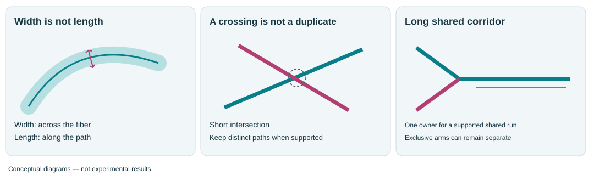
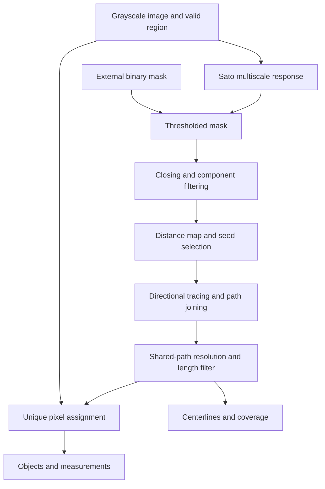
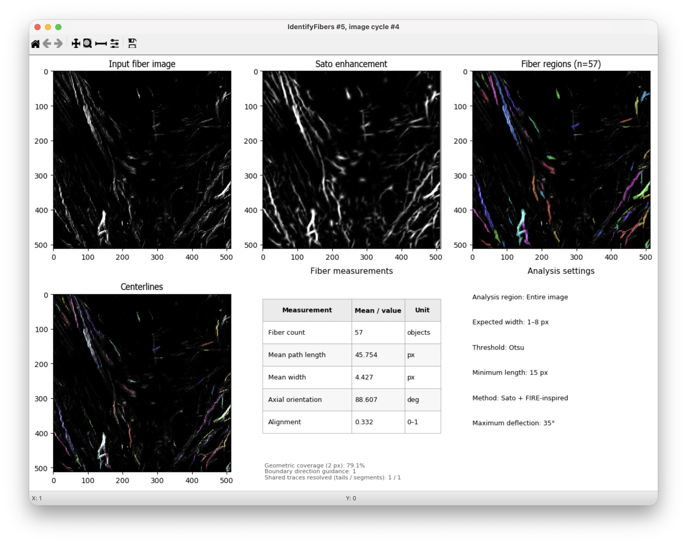

# IdentifyFibers user manual

**Sato + FIRE-inspired · Version 1.0.0 · 2D images**

[Português](manual.pt-BR.md) · [Repository home](../README.md)

## Contents

- [Scope and scientific basis](#scope-and-scientific-basis)
- [Quick start](#quick-start)
- [Parameter adjustment](#parameter-adjustment)
- [Processing stages](#processing-stages)
- [Reading the outputs](#reading-the-outputs)
- [Measurements and export](#measurements-and-export)
- [Troubleshooting](#troubleshooting)
- [Reproducibility and references](#reproducibility-and-references)

## Scope and scientific basis

A collagen image can contain isolated fibers, intertwined bundles and crossing structures with similar fluorescence. Extracting an elongated object does not, by itself, establish that it represents one biological fiber. IdentifyFibers provides centerlines and pixel regions so that these two representations can be checked against the original signal.

This plugin is **based on FIRE (Fiber Extraction)**, particularly the principles of seed selection within a network and directional extension of fiber paths described by Stein et al. [1]. It is an independent Python implementation for **2D**, with **Sato enhancement** [2] instead of curvelet preprocessing. It is neither the original FIRE/CT-FIRE software nor a numerically equivalent implementation. It does not reconstruct a 3D network from a 2D projection.

## Quick start

1. Choose a grayscale image in which fibers are brighter than the background. If a previous module has changed intensities, the plugin measures that supplied image, not the original acquisition file.
2. Choose **Entire image**, or **Within objects** with tissue regions already identified by another module. Parent boundaries clip fibers; they are not merely display regions.
3. Set expected fiber widths in **pixels**, using several representative structures. Start from the apparent transverse thickness, not the length of the structure.
4. Start with **Otsu**, correction factor **1**, minimum length **15 px**, and FFT off. These are software defaults, not validated biological thresholds.
5. In test mode, inspect thin fibers, broad bundles, faint segments and junctions. Compare the original, enhancement, centerlines and regions at the same zoom.
6. Adjust one parameter at a time. Keep settings consistent across a biological comparison once selected on representative images; do not tune each image to obtain a desired count.
7. Add **ExportToSpreadsheet** for measurements and **SaveImages** for the named images. Save the pipeline and record the plugin version.

**Spatial scale.** The interface uses pixels. For an illustrative acquisition with 0.5 µm/pixel, 4 µm corresponds to 8 pixels. Convert measured lengths by the pixel size and areas by its square. The plugin does not automatically apply microscope metadata calibration. Use isotropic in-plane sampling; otherwise geometry in pixel coordinates is distorted.

## Parameter adjustment

### Start with signal and size

| Control | Default | Increasing the value | Decreasing the value |
|---|---:|---|---|
| Minimum expected fiber width | 1 px | Reduces emphasis on the finest structures; thin fibers can disappear. | Samples finer structures, including possible noise. |
| Maximum expected fiber width | 8 px | Includes broader structures and bundles; may blur distinctions between neighboring fibers. | Concentrates enhancement on thinner structures; broad fibers may be missed. |
| Threshold correction factor | 1 | Restricts Otsu/Li segmentation; removes weak signal but can interrupt fibers. | Retains faint segments but may also include background and false connections. |
| Minimum fiber length | 15 px | Rejects more short paths, including genuine short fibers. | Preserves short branches and fragments, including possible noise. |

The width limits select **enhancement scales**, not hard cutoffs on measured width. Increasing the maximum does not explicitly ask for longer fibers. Minimum length filters completed paths; it cannot repair gaps. If a long fiber becomes several short paths, raising minimum length can hide the failure rather than resolve it.

**Practical tuning order:** first width range, then segmentation threshold, then continuity, then object boundaries. For a faint missing segment, compare correction factors such as 1.0 and 0.9 as a small trial, keeping all other values fixed. Retain the change only if the original image supports the added structure. These examples are starting experiments, not universal settings.

### Choose the segmentation source

| Method | Meaning and adjustment |
|---|---|
| Otsu / Li | Estimate a threshold from positive Sato responses. Correction factor and lower/upper bounds apply. |
| Manual | Uses a threshold in normalized enhancement, from 0 to 1; default 0.15. Higher excludes weaker signal; lower includes it and potentially background. |
| Percentile | Uses an enhancement percentile; default 75. Higher generally retains fewer pixels. This is not a target percentage of fibers. |
| CellProfiler binary image | Uses a same-size binary image, such as a Threshold output. Sato remains available for inspection but does not define segmentation. Closing and minimum component area still apply. |

To analyze **without enhancement-driven segmentation**, generate a binary mask from your chosen input upstream and select **CellProfiler binary image**. This bypasses Sato as the segmentation source; it does not bypass tracing or region assignment. Keep the original grayscale signal as the fiber input if you want intensity measurements from that signal.

### Advanced controls

Hidden values remain active. Turning **Show advanced settings** off does not restore defaults.

| Control | Default | What increasing/decreasing changes biologically or geometrically |
|---|---:|---|
| Number of enhancement scales | 4 | More scales sample the width interval more finely and take longer; fewer sample it more coarsely. More does not guarantee better separation. With 1, only the minimum scale is used. |
| Closing radius | 1 px | Larger closing can fill small mask gaps, but also join neighboring fibers. Smaller preserves gaps; 0 disables closing. |
| Minimum segmented area | 10 px² | Larger removes small isolated mask components; smaller retains them. This is applied before tracing and does not remove individual short fibers inside a connected network. |
| Maximum crossing deflection | 35° | Larger permits sharper turns and possible switches at junctions; smaller favors straight continuation but can truncate curved fibers. |
| Minimum points for branch direction | 5 | Larger smooths directional estimates but can miss tight bends; smaller follows local irregularities and noise. The actual window also depends on local width. |
| Direction guidance for object boundaries | 1 | Larger favors transverse expansion from centerlines; smaller gives more relative influence to distance and input intensity. Zero removes the directional term. It neither changes paths nor creates a separating gap. |
| Lower threshold bound | 0 | Raising the floor restricts very low Otsu/Li thresholds and can discard faint fibers. Lowering it permits lower thresholds. It acts only if the calculated value falls below the bound. |
| Upper threshold bound | 1 | Lowering the ceiling limits high Otsu/Li thresholds and can retain weak signal/background. Raising it permits stricter thresholds. It acts only if the calculated value exceeds the bound. |
| Neighbor search radius | 30 px | Larger includes more centroid neighbors and fewer isolated fibers; smaller measures a more local neighborhood. It never joins fibers or changes segmentation. |
| FFT minimum frequency | 0.02 cycles/px | Raising it excludes broad spatial variations; lowering it includes larger-scale structure and possible background gradients. |
| FFT maximum frequency | 0.45 cycles/px | Raising it includes finer detail and possible noise; lowering it removes high-frequency detail. Both FFT controls affect only the Fourier analysis. |

Image/object name fields define output names, not biological thresholds. **FFT** is off by default; enable it for an additional image-based orientation measure. Keep its minimum frequency below its maximum.

## Processing stages

The following describes this implementation, not a claim that every CT-FIRE stage has been reproduced.

1. **Input and analysis region.** Nonfinite and masked-out pixels are excluded. Each parent object is processed independently in Within objects mode. Input intensity is retained for measurements.
2. **Normalization and Sato enhancement.** Valid intensities are rescaled using the 1st and 99.5th percentiles, then Sato highlights bright elongated structures over the selected scales. The response is normalized again. The Gaussian scales are sampled between `max(0.5, minimum_width/2)` and `max(0.5, maximum_width/2)`. Consequently, width settings are practical scale guides, not calibrated diameter estimates.
3. **Segmentation and mask cleanup.** Thresholding selects candidate foreground, or an external binary mask supplies it. Disk closing can connect small gaps, and connected components below minimum area are removed. These operations can alter topology before tracing; inspect their biological plausibility.
4. **Distance map and nucleation.** Distance to the mask background identifies interior ridges. Local distance maxima provide seeds, with deterministic selection and fallback for components without a selected seed. A skeleton is not used to seed or extend the FIRE-inspired paths.
5. **Directional extension and joining.** Paths grow in both directions from seeds, seeking local distance maxima on surrounding square perimeters. Candidate connections must remain inside foreground. Local direction and deflection restrict continuation; compatible path ends can be joined. This is the FIRE-inspired nucleation/extension part, with independent Python implementation choices.
6. **Duplicate and shared-path resolution.** Similar retraces are suppressed. Long near-parallel shared runs are resolved using supported proximity, direction and continuity. One path retains the shared corridor; exclusive remaining arms may survive as separate paths if they meet the length criterion. Short crossings are treated differently from long duplicated runs. Nearby paths are not automatically merged solely because they touch. The plugin also checks slightly offset paths inside broad fibers, using local mask width and the original intensity. A transverse intensity valley protects resolved neighboring strands; a sustained change of side protects shallow crossings. Wider matches require a longer shared run. The winning path keeps the common segment, while exclusive arms are retained subject to the length filter. Some ambiguous duplicates can remain, especially where the image does not resolve individual strands.
7. **Length filtering and object partition.** Paths below minimum length are rejected. Accepted centerlines seed a multi-source geodesic partition within foreground components containing an accepted path. Distance, changes in original intensity and a local directional term govern pixel assignment. Each assigned pixel receives exactly one object label; no artificial exclusion strip is introduced between objects. Isolated components without an accepted seed remain unassigned. In a retained connected component, pixels of a rejected short branch can still be assigned to another accepted fiber.
8. **Measurement and quality control.** Path geometry, mask-based width, region intensity and centroid-based neighborhood measures are calculated. A separate skeleton of the segmented mask provides the geometric-coverage reference. Optional FFT uses the original image, independently of the object segmentation.

### Why use whole centerlines instead of centroids for division?

A centroid is one point and can lie far from a curved fiber. Using the whole centerline as the seed better represents the fiber's extent. Intensity and local direction then guide which nearby pixels belong to which seed. However, a partition cannot fix a wrong centerline identity: two paths following the same bright ridge must be addressed at the tracing/shared-path stage, not simply by changing region boundaries.

## Reading the outputs

| Output | Interpretation |
|---|---|
| Input fiber image | Signal supplied to the plugin. |
| Sato enhancement / FiberEnhanced | Enhanced elongated structures; not the intensity-measurement image. |
| Fiber regions / Fibers | Nonoverlapping labeled pixel regions. Similar colors do not establish identical labels. |
| Centerlines | Accepted paths, colored by object identity. At an exactly shared display pixel, one color is drawn; the overlay alone cannot prove absence of path overlap. |
| FiberSkeleton | Binary detected paths before minimum-length filtering, after shared-path handling. It is not an object-label image. |
| FiberUncoveredSkeleton | Reference-mask skeleton pixels farther than 2 px from an accepted centerline. |
| FiberFFTReport / FiberFFTDistribution | Optional whole-image Fourier report and distribution plot. These remain whole-image outputs in Within objects mode; parent FFT measurements are exported separately. |

**Geometric coverage** is `100 × covered reference-skeleton pixels / all reference-skeleton pixels`, with a fixed **2 px** tolerance. It is undefined when no reference skeleton exists. This is neither a percentage of biological fibers recovered nor segmentation accuracy. An incorrect broad mask can have high coverage. Do not divide measurements by coverage or tune parameters solely to maximize it. The 2 px value is a diagnostic tolerance, not a minimum distance enforced between fibers.

The measurement panel restores a bordered table with **Measurement / Mean–value / Unit**. Count covers all accepted fibers in the analysis, not only the displayed zoom. Shared-tail/segment repair counters count algorithmic corrections, not validated biological errors. The default analysis-settings panel is replaced by the FFT distribution when FFT is enabled.

Representative output selected for the first public release. This user-provided CellProfiler screenshot shows 79 objects, expected widths of 1–4 px, Otsu thresholding, minimum path length of 15 px and maximum deflection of 35°. These are example settings, not the plugin defaults or a validated biological fiber count. The underlying image and complete pipeline for this example are not included; the screenshot is not a reproducible benchmark. 

## Measurements and export

| Field | Definition and interpretation |
|---|---|
| `Count_Fibers` | Accepted object count; `Fibers` changes with the chosen object name. It is not a count of molecular collagen fibrils. |
| `Fiber_CenterlineLength` | Sum of distances along the traced path, in pixels. The table's mean path length uses this field. |
| `Fiber_Length` | Major-axis length of the final region. **Legacy naming:** not curved path length. `FiberSummary_TotalLength`, `MeanLength`, `MedianLength` and `StdLength` retain this major-axis definition. |
| `Fiber_EndToEndLength` | Straight distance between path endpoints. |
| `Fiber_Straightness` / `Fiber_Tortuosity` | End-to-end/path length and its reciprocal. Undefined ratios are exported as NaN where applicable. |
| `Fiber_WidthMean`, `WidthMedian`, `WidthMaximum` | Twice the distance to mask background along the path, before region partition. Junctions or merged bundles can inflate width; dividing region pixels does not correct this width estimate. |
| `Fiber_Orientation` | Principal direction of path coordinates, axial 0–180°. Horizontal is 0°, vertical 90°; image y increases downward. Curved fibers receive one global direction. |
| `Fiber_IntensityMean`, `IntensityMaximum`, `IntensityIntegrated` | Original input signal over assigned region pixels; integrated intensity is their sum. In a projected crossing, the biological signal from different fibers cannot be uniquely separated from this image alone. |
| `Fiber_CenterX`, `CenterY` | Final region centroid, not the midpoint of the traced path. |
| `Fiber_NearestCentroidDistance` | Distance to the closest other fiber centroid in the same parent, irrespective of the neighborhood cutoff; NaN if none exists. |
| `Fiber_NeighborAlignment` / `Fiber_Isolated` | Directional agreement with centroid neighbors inside the chosen radius; isolation indicates no such neighbors. No neighbor alignment is reported when undefined. |
| `FiberSummary_AlignmentCoefficient` | Axial resultant across accepted fiber orientations: near 1 for shared direction, near 0 for dispersed or balanced perpendicular populations. It weights fibers equally, not by length. |
| `FiberFFT_Orientation` / `FiberFFT_Alignment` | Power-weighted axial orientation and alignment of the original image within the frequency band. Different weighting means these need not match per-fiber statistics. |

Use **MeasureObjectSizeShape** on Fibers if you need explicit region area measurements. In Within objects mode, exports also include parent links and child counts. Region areas/intensities have unique pixel ownership, but centerlines can intersect, and persistent duplicated trajectories can still bias path-based measurements.

## Troubleshooting

| Observation | First check and adjustment |
|---|---|
| Thin fibers disappear | Inspect the original signal and minimum width; test a smaller scale or slightly lower threshold if the signal supports it. |
| Weak stretches break | Lower the Otsu/Li correction modestly and inspect background inclusion. Raising minimum length cannot reconnect them. |
| Nearby fibers become a broad region | Check maximum width, threshold and closing. Test closing 0 before assuming the two structures form one fiber. |
| One fiber has two centerlines | Inspect whether the paths share a long corridor or represent two resolved strands. Boundary-direction weight will not remove duplicated paths. The automatic identity check now also examines wider shared runs and transverse intensity valleys. If duplication persists, save the raw image and exact pipeline to reproduce that particular case. |
| Good centerlines, unsuitable region boundary | Inspect the original intensity and mask, then vary direction guidance while holding tracing settings fixed. A blurred unresolved crossing may remain ambiguous. |
| Many small detections | Distinguish real short fibers from noise; adjust minimum length or isolated component area accordingly. |
| Low coverage | Inspect FiberUncoveredSkeleton; check missing faint branches, overstrict length filtering, segmentation errors and tracing failures. There is no universal target coverage. |
| FFT and fiber alignment differ | They use different inputs/weighting. Check frequency limits, mask shape and image artifacts before interpreting the difference biologically. |

### Image-supported duplicate-path correction

The previous partial-overlap check used a fixed 1.5 px centerline distance. It could miss slightly offset retraces inside a broad fiber. The new check retains that narrow comparison and adds a width-dependent comparison, capped at 4 px. This broader comparison requires at least 12 px and three local widths of shared path, supported foreground connections, compatible directions and reciprocal path matching. A drop of more than 20% below the dimmer endpoint in the lightly smoothed transverse intensity profile vetoes that match. This is an algorithmic image-evidence criterion, not a calibrated biological threshold.

A sustained side switch is treated as evidence of a crossing rather than a duplicate. Without usable intensity contrast, wider matching is disabled. No new controls are needed; existing pipeline settings remain compatible. The segmentation mask is not eroded, and no exclusion gap is inserted. The correction operates on path identity before the usual length filter and pixel partition. It does not establish how many biological fibers lie inside an unresolved or saturated bundle.

A lower object count alone is not evidence of improvement: the revision can also preserve a crossing that an earlier rule incorrectly trimmed.

## Reproducibility and references

Record image pixel size, preprocessing, input image name, parent regions, plugin version, complete pipeline settings and representative overlays. Keep acquisition and analysis settings comparable across groups. Use original image data, not a screenshot, when reporting an unresolved overlap. An annotated crossing and the saved `.cppipe` identify the exact failure more reliably than an overview alone.

**Methods wording to adapt:** “Bright structures were analyzed in CellProfiler using IdentifyFibers [version], an independent 2D Python implementation combining Sato enhancement with FIRE-inspired tracing (Stein et al., 2008). Expected widths were [values] px, segmentation used [method and values], and paths shorter than [value] px were excluded.” Fill only parameters actually used; this is not a completed Methods statement.

1. **Stein AM, Vader DA, Jawerth LM, Weitz DA, Sander LM.** An algorithm for extracting the network geometry of three-dimensional collagen gels. *Journal of Microscopy*. 2008;232(3):463–475. [doi:10.1111/j.1365-2818.2008.02141.x](https://doi.org/10.1111/j.1365-2818.2008.02141.x). Original FIRE reference; supports the methodological inspiration, not validation of this plugin.
2. **Sato Y, Nakajima S, Shiraga N, Atsumi H, Yoshida S, Koller T, Gerig G, Kikinis R.** Three-dimensional multi-scale line filter for segmentation and visualization of curvilinear structures in medical images. *Medical Image Analysis*. 1998;2(2):143–168. [doi:10.1016/S1361-8415(98)80009-1](https://doi.org/10.1016/S1361-8415(98)80009-1).

Original FIRE copyright and license are retained in [LICENSE_FIRE.txt](../LICENSE_FIRE.txt); see [NOTICE.txt](../NOTICE.txt). The software is not endorsed by the original FIRE authors.
