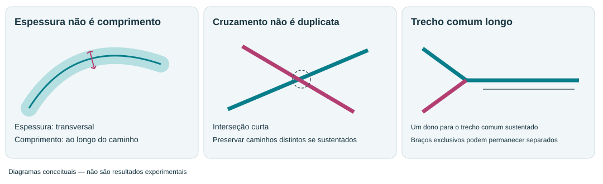
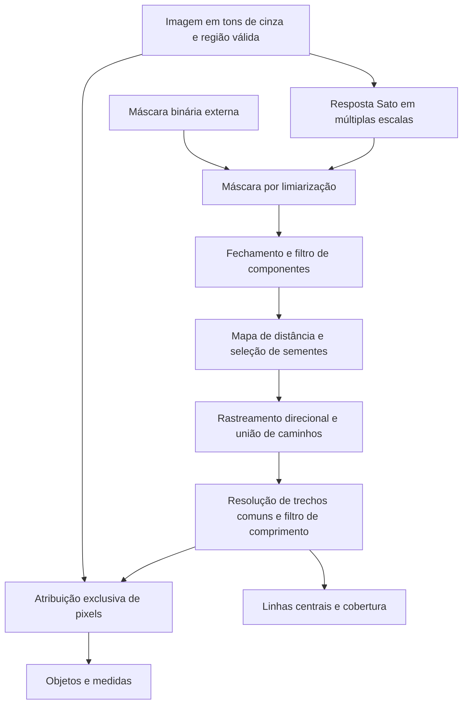
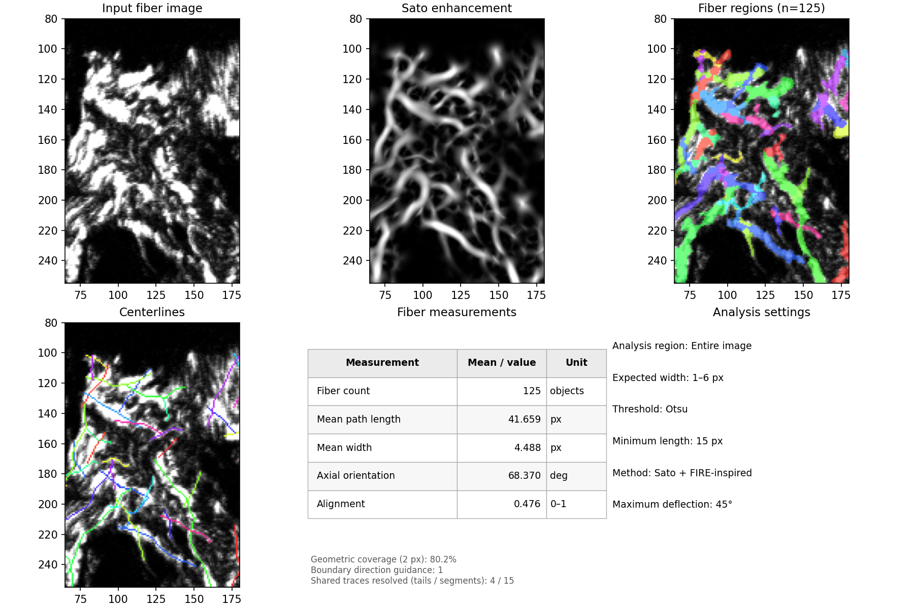

# Manual de uso do IdentifyFibers

**Sato + FIRE-inspired · Versão 0.3.2 · Imagens 2D**

[English](manual.en.md) · [Página inicial](../README.pt-BR.md)

## Conteúdo

- [Escopo e base científica](#escopo-e-base-científica)
- [Início rápido](#início-rápido)
- [Ajuste dos parâmetros](#ajuste-dos-parâmetros)
- [Etapas de processamento](#etapas-de-processamento)
- [Interpretação das saídas](#interpretação-das-saídas)
- [Medidas e exportação](#medidas-e-exportação)
- [Resolução de problemas](#resolução-de-problemas)
- [Reprodutibilidade e referências](#reprodutibilidade-e-referências)

## Escopo e base científica

Uma imagem de colágeno pode conter fibras isoladas, feixes entrelaçados e estruturas que se cruzam com intensidade semelhante. A extração de um objeto alongado, por si só, não estabelece que ele corresponda a uma única fibra biológica. O IdentifyFibers fornece linhas centrais e regiões de pixels para que essas duas representações sejam confrontadas com o sinal original.

O plugin é **baseado no FIRE (Fiber Extraction)**, particularmente nos princípios de seleção de sementes no interior da rede e extensão direcional das trajetórias descritos por Stein et al. [1]. Trata-se de uma implementação Python independente para **2D**, com **realce Sato** [2] em lugar do pré-processamento por curvelets. Não é o FIRE/CT-FIRE original nem uma implementação com equivalência numérica demonstrada. Também não reconstrói uma rede tridimensional a partir de uma projeção 2D.

A interface do CellProfiler oferece somente Sato + FIRE-inspired. Não requer MATLAB ou executável externo de rastreamento. O código utiliza bibliotecas científicas Python disponíveis no ambiente do CellProfiler. Consulte a [instalação](../README.pt-BR.md#instalação) e os [limites da validação](../VALIDATION.md).

## Início rápido

1. Escolha uma imagem em tons de cinza com fibras mais claras que o fundo. Se um módulo anterior alterou as intensidades, o plugin medirá essa imagem fornecida, e não o arquivo original da aquisição.
2. Selecione **Entire image** ou **Within objects**, com regiões de tecido previamente identificadas. As bordas dos objetos parentais interrompem as fibras; não são apenas limites de visualização.
3. Ajuste a faixa de espessuras esperadas em **pixels**, observando várias estruturas representativas. Use a espessura aparente transversal, não o comprimento da fibra.
4. Comece com **Otsu**, fator de correção **1**, comprimento mínimo **15 px** e FFT desligada. São padrões do software, não limites biológicos validados.
5. No modo de teste, inspecione fibras finas, feixes largos, trechos fracos e junções. Compare imagem original, realce, linhas centrais e regiões na mesma ampliação.
6. Altere um parâmetro por vez. Após escolher os ajustes em imagens representativas, mantenha-os consistentes na comparação biológica; não ajuste cada imagem para obter uma contagem desejada.
7. Adicione **ExportToSpreadsheet** para as medidas e **SaveImages** para as imagens nomeadas. Salve o pipeline e registre a versão do plugin.

**Escala espacial.** A interface utiliza pixels. Em uma aquisição ilustrativa com 0,5 µm/pixel, 4 µm correspondem a 8 pixels. Converta comprimentos pelo tamanho do pixel e áreas pelo quadrado desse fator. O plugin não aplica automaticamente a calibração dos metadados do microscópio. Utilize amostragem isotrópica no plano; caso contrário, a geometria em coordenadas de pixels estará distorcida.

## Ajuste dos parâmetros

### Comece pelo sinal e pelas dimensões

Os nomes dos controles permanecem em inglês para corresponder à interface.

| Controle | Padrão | Ao aumentar | Ao diminuir |
|---|---:|---|---|
| Minimum expected fiber width | 1 px | Reduz a ênfase nas estruturas mais finas; fibras delgadas podem desaparecer. | Amostra estruturas mais finas, incluindo possível ruído. |
| Maximum expected fiber width | 8 px | Inclui estruturas mais largas e feixes; pode reduzir a distinção entre fibras vizinhas. | Concentra o realce em estruturas mais finas; fibras largas podem ser perdidas. |
| Threshold correction factor | 1 | Restringe a segmentação por Otsu/Li; remove sinal fraco, mas pode interromper fibras. | Preserva trechos fracos, mas pode incluir fundo e conexões falsas. |
| Minimum fiber length | 15 px | Exclui mais trajetórias curtas, inclusive fibras curtas verdadeiras. | Preserva ramos curtos e fragmentos, incluindo possível ruído. |

Os limites de espessura selecionam **escalas de realce**, e não cortes rígidos sobre a largura medida. Aumentar a largura máxima não solicita explicitamente fibras mais longas. O comprimento mínimo filtra trajetórias já construídas; não repara lacunas. Se uma fibra longa foi fragmentada em caminhos curtos, elevar esse mínimo pode ocultar a falha em vez de resolvê-la.

**Ordem prática de ajuste:** primeiro a faixa de espessuras, depois o limiar de segmentação, a continuidade e, por último, as fronteiras dos objetos. Para um trecho fraco ausente, compare fatores como 1,0 e 0,9 em um pequeno teste, mantendo os demais valores. Aceite a alteração apenas se a imagem original sustentar a estrutura adicionada. Esses exemplos são ensaios iniciais, não configurações universais.

### Escolha a origem da segmentação

| Método | Significado e ajuste |
|---|---|
| Otsu / Li | Estimam um limiar a partir das respostas positivas do Sato. Aplicam-se fator de correção e limites inferior/superior. |
| Manual | Utiliza um limiar entre 0 e 1 no realce normalizado; padrão 0,15. Valores maiores excluem sinal fraco; menores o incluem, possivelmente com fundo. |
| Percentile | Utiliza um percentil do realce; padrão 75. Aumentar geralmente preserva menos pixels. Não corresponde a uma porcentagem desejada de fibras. |
| CellProfiler binary image | Utiliza uma imagem binária de mesmo tamanho, como a saída de Threshold. O Sato continua disponível para inspeção, mas não define a segmentação. Fechamento e área mínima de componentes ainda se aplicam. |

Para analisar **sem segmentação determinada pelo realce**, produza uma máscara binária a partir da imagem desejada em um módulo anterior e selecione **CellProfiler binary image**. Essa opção substitui a origem da segmentação; não desativa o rastreamento ou a atribuição de regiões. Mantenha o sinal original em tons de cinza como entrada das fibras se quiser medir sua intensidade.

### Controles avançados

Os valores ocultos permanecem ativos. Desligar **Show advanced settings** não restaura os padrões.

| Controle | Padrão | Efeito biológico ou geométrico de aumentar/diminuir |
|---|---:|---|
| Number of enhancement scales | 4 | Mais escalas amostram a faixa de espessuras com maior detalhe e exigem mais tempo; menos escalas tornam essa amostragem mais grosseira. Mais escalas não garantem melhor separação. Com 1, somente a escala mínima é utilizada. |
| Closing radius | 1 px | Um fechamento maior pode preencher pequenas falhas, mas também unir fibras vizinhas. Diminuir preserva separações; 0 desativa o fechamento. |
| Minimum segmented area | 10 px² | Aumentar remove componentes pequenos e isolados da máscara; diminuir os preserva. Atua antes do rastreamento e não exclui individualmente fibras curtas dentro de uma rede conectada. |
| Maximum crossing deflection | 35° | Aumentar permite curvas mais acentuadas e possíveis trocas de fibra nas junções; diminuir favorece continuidade reta, mas pode interromper fibras curvas. |
| Minimum points for branch direction | 5 | Aumentar suaviza a estimativa direcional, mas pode perder curvas fechadas; diminuir acompanha irregularidades locais e ruído. A janela efetiva também depende da largura local. |
| Direction guidance for object boundaries | 1 | Aumentar favorece expansão transversal às linhas centrais; diminuir dá maior influência relativa à distância e à intensidade de entrada. Zero remove o termo direcional. Não altera trajetórias nem cria uma faixa de exclusão. |
| Lower threshold bound | 0 | Elevar o piso restringe limiares Otsu/Li muito baixos e pode excluir fibras fracas. Reduzi-lo permite limiares menores. Atua somente quando o valor calculado fica abaixo desse limite. |
| Upper threshold bound | 1 | Reduzir o teto limita limiares Otsu/Li altos e pode preservar sinal fraco/fundo. Elevá-lo permite maior restrição. Atua somente quando o valor calculado ultrapassa esse limite. |
| Neighbor search radius | 30 px | Aumentar inclui mais vizinhos por distância entre centroides e reduz o número de isoladas; diminuir mede uma vizinhança mais local. Nunca une fibras nem altera a segmentação. |
| FFT minimum frequency | 0,02 ciclos/px | Aumentar exclui variações espaciais amplas; diminuir inclui estruturas de maior escala e possíveis gradientes de fundo. |
| FFT maximum frequency | 0,45 ciclos/px | Aumentar inclui detalhes finos e possível ruído; diminuir remove detalhes de alta frequência. Ambos os controles afetam apenas a análise de Fourier. |

Os campos de nome de imagem/objeto definem as saídas, não limites biológicos. A **FFT** vem desligada; ative-a para uma medida adicional de orientação baseada na imagem. Mantenha a frequência mínima abaixo da máxima.

## Etapas de processamento

A descrição abaixo corresponde a esta implementação e não afirma que todas as etapas do CT-FIRE foram reproduzidas.

1. **Entrada e região de análise.** Pixels não finitos ou excluídos pela máscara são desconsiderados. Em Within objects, cada objeto parental é processado independentemente. A intensidade de entrada é preservada para as medidas.
2. **Normalização e realce Sato.** As intensidades válidas são reescaladas pelos percentis 1 e 99,5; o Sato destaca estruturas claras e alongadas nas escalas selecionadas. A resposta é normalizada novamente. As escalas gaussianas são amostradas entre `max(0.5, minimum_width/2)` e `max(0.5, maximum_width/2)`. Portanto, os controles de espessura orientam a escala do realce, sem constituir estimativas calibradas de diâmetro.
3. **Segmentação e tratamento da máscara.** A limiarização seleciona o primeiro plano candidato, ou uma máscara binária externa o fornece. O fechamento com disco pode conectar pequenas lacunas, e componentes abaixo da área mínima são removidos. Essas operações podem alterar a topologia antes do rastreamento; sua plausibilidade biológica deve ser inspecionada.
4. **Mapa de distância e nucleação.** A distância ao fundo da máscara evidencia regiões internas. Máximos locais fornecem sementes, com seleção determinística e uma alternativa para componentes sem semente selecionada. Um skeleton não é utilizado para iniciar ou estender as trajetórias FIRE-inspired.
5. **Extensão direcional e união.** As trajetórias crescem em duas direções a partir das sementes, buscando máximos locais de distância em perímetros quadrados ao redor da posição atual. As conexões candidatas devem permanecer no primeiro plano. Direção local e deflexão restringem a continuidade; extremidades compatíveis podem ser unidas. Essa é a parte de nucleação/extensão inspirada no FIRE, com escolhas próprias da implementação Python.
6. **Resolução de duplicatas e trechos compartilhados.** Rastreamentos muito semelhantes são suprimidos. Trechos longos, próximos e aproximadamente paralelos são resolvidos considerando suporte na máscara, direção e continuidade. Uma trajetória conserva o trecho comum; os braços exclusivos restantes podem sobreviver como caminhos separados se cumprirem o comprimento mínimo. Cruzamentos curtos são tratados de maneira diferente de percursos longos duplicados. Trajetórias próximas não são automaticamente unidas apenas por se tocarem. A versão 0.3.2 também examina caminhos ligeiramente deslocados dentro de fibras largas, utilizando a largura local da máscara e a intensidade original. Um vale transversal de intensidade protege estruturas vizinhas resolvidas; uma mudança sustentada de lado protege cruzamentos em ângulo pequeno. Correspondências mais largas exigem um trecho comum mais longo. A trajetória escolhida conserva o segmento comum, e os braços exclusivos são preservados, sujeitos ao filtro de comprimento. Algumas duplicatas ambíguas podem permanecer, sobretudo quando a imagem não resolve as estruturas individuais.
7. **Filtro de comprimento e divisão dos objetos.** Caminhos menores que o mínimo são rejeitados. As linhas centrais aceitas servem como sementes de uma divisão geodésica com múltiplas origens, restrita aos componentes de primeiro plano que contêm uma trajetória aceita. Distância, mudanças na intensidade original e um termo direcional local governam a atribuição. Cada pixel atribuído recebe um único rótulo; não se introduz uma faixa artificial de exclusão entre objetos. Componentes isolados sem semente aceita permanecem sem atribuição. Em um componente conectado preservado, pixels de um ramo curto rejeitado ainda podem ser atribuídos a outra fibra aceita.
8. **Medidas e controle de qualidade.** São calculadas geometria das trajetórias, largura baseada na máscara, intensidade das regiões e vizinhança entre centroides. Um esqueleto separado da máscara segmentada fornece a referência da cobertura geométrica. A FFT opcional utiliza a imagem original, independentemente da segmentação dos objetos.

### Por que dividir a partir das linhas centrais inteiras, e não dos centroides?

O centroide é um único ponto e pode ficar distante de partes de uma fibra curva. A linha central inteira representa melhor a extensão da fibra como semente. Intensidade e direção local orientam, então, quais pixels vizinhos pertencem a cada trajetória. Entretanto, uma divisão de pixels não corrige uma identidade de trajetória incorreta: dois caminhos sobre a mesma estrutura precisam ser tratados no rastreamento ou na resolução de trechos compartilhados, e não apenas pela alteração das fronteiras dos objetos.

## Interpretação das saídas

| Saída | Interpretação |
|---|---|
| Input fiber image | Sinal fornecido ao plugin. |
| Sato enhancement / FiberEnhanced | Estruturas alongadas realçadas; não é a imagem utilizada para medir intensidade. |
| Fiber regions / Fibers | Regiões de pixels rotuladas sem sobreposição. Cores semelhantes não estabelecem identidade de rótulo. |
| Centerlines | Trajetórias aceitas, coloridas pela identidade do objeto. Em um pixel de visualização exatamente compartilhado, uma cor é desenhada; a sobreposição visual sozinha não comprova ausência de caminhos sobrepostos. |
| FiberSkeleton | Caminhos binários detectados antes do filtro de comprimento mínimo, após o tratamento dos trechos compartilhados. Não é uma imagem de rótulos de objetos. |
| FiberUncoveredSkeleton | Pixels do esqueleto de referência da máscara a mais de 2 px de uma linha central aceita. |
| FiberFFTReport / FiberFFTDistribution | Relatório e distribuição de Fourier opcionais para a imagem inteira. Continuam sendo saídas da imagem inteira em Within objects; as medidas FFT por objeto parental são exportadas separadamente. |

A **cobertura geométrica** é `100 × pixels cobertos do esqueleto de referência / todos os pixels desse esqueleto`, com tolerância fixa de **2 px**. É indefinida quando não existe esqueleto de referência. Não representa a porcentagem de fibras biológicas recuperadas nem a acurácia da segmentação. Uma máscara larga e incorreta pode apresentar cobertura alta. Não divida medidas pela cobertura nem ajuste os parâmetros apenas para maximizá-la. Os 2 px são uma tolerância diagnóstica, não uma distância mínima imposta entre fibras.

O painel de medidas utiliza uma tabela com bordas e colunas **Measurement / Mean–value / Unit**. A contagem abrange todas as fibras aceitas na análise, não apenas a área ampliada. Os contadores de reparos de extremidades/segmentos compartilhados indicam correções algorítmicas, não erros biológicos validados. Quando ativada, a distribuição FFT substitui o painel de configurações.

Exemplo da tabela restaurada; imagem de regressão, não a captura mais recente. Consulte os [detalhes da validação](../VALIDATION.md).

## Medidas e exportação

| Campo | Definição e interpretação |
|---|---|
| `Count_Fibers` | Contagem de objetos aceitos; `Fibers` acompanha o nome escolhido para os objetos. Não corresponde à contagem de fibrilas moleculares de colágeno. |
| `Fiber_CenterlineLength` | Soma das distâncias ao longo da trajetória, em pixels. O comprimento médio mostrado na tabela utiliza esse campo. |
| `Fiber_Length` | Comprimento do eixo maior da região final. **Nome legado:** não é o comprimento percorrido por uma fibra curva. `FiberSummary_TotalLength`, `MeanLength`, `MedianLength` e `StdLength` mantêm essa definição de eixo maior. |
| `Fiber_EndToEndLength` | Distância reta entre as extremidades da trajetória. |
| `Fiber_Straightness` / `Fiber_Tortuosity` | Razão distância entre extremidades/comprimento do caminho e sua recíproca. Razões indefinidas são exportadas como NaN quando aplicável. |
| `Fiber_WidthMean`, `WidthMedian`, `WidthMaximum` | Duas vezes a distância ao fundo da máscara ao longo da trajetória, antes da divisão das regiões. Junções ou feixes unidos podem aumentar a estimativa; dividir os pixels dos objetos não corrige essa largura. |
| `Fiber_Orientation` | Direção principal das coordenadas da trajetória, axial entre 0 e 180°. Horizontal corresponde a 0° e vertical a 90°; o eixo y da imagem cresce para baixo. Fibras curvas recebem uma direção global. |
| `Fiber_IntensityMean`, `IntensityMaximum`, `IntensityIntegrated` | Sinal de entrada original nos pixels atribuídos à região; a intensidade integrada é sua soma. Em um cruzamento projetado, não é possível separar de maneira única o sinal biológico de cada fibra apenas com essa imagem. |
| `Fiber_CenterX`, `CenterY` | Centroide da região final, não o ponto médio do caminho traçado. |
| `Fiber_NearestCentroidDistance` | Distância ao centroide de outra fibra mais próxima no mesmo objeto parental, independentemente do limite de vizinhança; NaN se não houver outra fibra. |
| `Fiber_NeighborAlignment` / `Fiber_Isolated` | Concordância direcional com vizinhas cujos centroides estão dentro do raio escolhido; isolamento indica ausência dessas vizinhas. O alinhamento de vizinhança não é informado quando indefinido. |
| `FiberSummary_AlignmentCoefficient` | Resultante axial entre orientações das fibras aceitas: próxima de 1 quando compartilham direção, próxima de 0 quando dispersas ou em populações perpendiculares equilibradas. Todas as fibras têm o mesmo peso, sem ponderação pelo comprimento. |
| `FiberFFT_Orientation` / `FiberFFT_Alignment` | Orientação axial e alinhamento ponderados pela potência da imagem original na faixa de frequências. Essa ponderação distinta permite diferenças em relação às estatísticas por fibra. |

Utilize **MeasureObjectSizeShape** sobre Fibers para obter medidas explícitas de área das regiões. Em Within objects, as exportações também incluem vínculos parentais e contagens de objetos filhos. Áreas e intensidades regionais têm atribuição exclusiva de pixels, mas linhas centrais podem se cruzar, e trajetórias duplicadas persistentes ainda podem introduzir viés nas medidas baseadas em caminhos.

## Resolução de problemas

| Observação | Primeiro exame e ajuste |
|---|---|
| Fibras finas desaparecem | Confira o sinal original e a largura mínima; teste escala menor ou limiar ligeiramente mais baixo, se houver suporte no sinal. |
| Trechos fracos ficam interrompidos | Reduza modestamente o fator Otsu/Li e inspecione a inclusão de fundo. Elevar o comprimento mínimo não reconecta esses trechos. |
| Fibras próximas formam uma região larga | Confira largura máxima, limiar e fechamento. Teste fechamento 0 antes de assumir que as duas estruturas formam uma fibra. |
| Uma fibra apresenta duas linhas centrais | Verifique se os caminhos compartilham um trecho longo ou representam duas estruturas resolvidas. O peso direcional das fronteiras não remove trajetórias duplicadas. A verificação automática de identidade agora também examina trechos compartilhados mais largos e vales transversais de intensidade. Se a duplicação persistir, salve imagem original e pipeline exato para reproduzir esse caso específico. |
| Linhas centrais adequadas, fronteira regional inadequada | Inspecione intensidade original e máscara; depois varie a orientação das fronteiras mantendo o rastreamento fixo. Um cruzamento borrado e não resolvido pode continuar ambíguo. |
| Muitas detecções pequenas | Distinga fibras curtas reais de ruído; ajuste comprimento mínimo ou área de componentes isolados conforme o problema. |
| Cobertura baixa | Examine FiberUncoveredSkeleton; procure ramos fracos ausentes, filtro de comprimento restritivo, erros de segmentação e falhas de rastreamento. Não há uma cobertura-alvo universal. |
| FFT e alinhamento das fibras diferem | Utilizam entradas/ponderações distintas. Confira faixa de frequência, formato da máscara e artefatos antes de interpretar biologicamente a diferença. |

### O que mudou na versão 0.3.2?

A comparação anterior de sobreposições parciais utilizava uma distância fixa de 1,5 px entre linhas centrais. Isso podia deixar passar rastreamentos ligeiramente deslocados dentro de uma fibra larga. A nova regra mantém essa comparação estreita e acrescenta uma comparação proporcional à largura, limitada a 4 px. A comparação ampliada exige um trecho comum de pelo menos 12 px e três larguras locais, conexões sustentadas pela máscara, direções compatíveis e correspondência recíproca entre caminhos. Uma queda superior a 20% em relação à extremidade menos intensa do perfil transversal, após suavização leve, impede essa correspondência. É um critério algorítmico de evidência na imagem, não um limite biológico calibrado.

Uma mudança sustentada de lado é tratada como evidência de cruzamento, em vez de duplicata. Sem contraste de intensidade utilizável, a comparação ampliada é desativada. Não há novos controles; os pipelines existentes permanecem compatíveis. A máscara de segmentação não é erodida e não se insere uma faixa de exclusão. A correção atua sobre a identidade das trajetórias antes do filtro habitual de comprimento e da divisão de pixels. Ela não estabelece quantas fibras biológicas existem em um feixe não resolvido ou saturado.

Consulte os [testes controlados e a comparação antes/depois na imagem de microscopia](../VALIDATION.md). Uma contagem menor, isoladamente, não comprova melhora: a revisão também pode preservar um cruzamento que a regra anterior cortava indevidamente.

## Reprodutibilidade e referências

Registre tamanho do pixel, pré-processamento, nome da imagem de entrada, regiões parentais, versão do plugin, configurações completas do pipeline e sobreposições representativas. Mantenha aquisição e análise comparáveis entre grupos. Utilize dados de imagem originais, não uma captura de tela, ao relatar uma sobreposição não resolvida. Um cruzamento anotado e o arquivo `.cppipe` identificam a falha com maior precisão que uma visão geral isolada.

**Formulação de Métodos para adaptar:** “As estruturas claras foram analisadas no CellProfiler com o IdentifyFibers [versão], implementação Python independente em 2D que combina realce Sato e rastreamento inspirado no FIRE (Stein et al., 2008). As larguras esperadas foram [valores] px, a segmentação utilizou [método e valores], e trajetórias menores que [valor] px foram excluídas.” Preencha somente os parâmetros efetivamente utilizados; esse modelo não é uma descrição metodológica concluída.

1. **Stein AM, Vader DA, Jawerth LM, Weitz DA, Sander LM.** An algorithm for extracting the network geometry of three-dimensional collagen gels. *Journal of Microscopy*. 2008;232(3):463–475. [doi:10.1111/j.1365-2818.2008.02141.x](https://doi.org/10.1111/j.1365-2818.2008.02141.x). Referência original do FIRE; fundamenta a inspiração metodológica, não a validação deste plugin.
2. **Sato Y, Nakajima S, Shiraga N, Atsumi H, Yoshida S, Koller T, Gerig G, Kikinis R.** Three-dimensional multi-scale line filter for segmentation and visualization of curvilinear structures in medical images. *Medical Image Analysis*. 1998;2(2):143–168. [doi:10.1016/S1361-8415(98)80009-1](https://doi.org/10.1016/S1361-8415(98)80009-1).

Copyright e licença originais do FIRE estão preservados em [LICENSE_FIRE.txt](../LICENSE_FIRE.txt); consulte [NOTICE.txt](../NOTICE.txt). O software não é endossado pelos autores originais do FIRE. Os limites conhecidos da validação e as instruções de teste estão em [VALIDATION.md](../VALIDATION.md).
